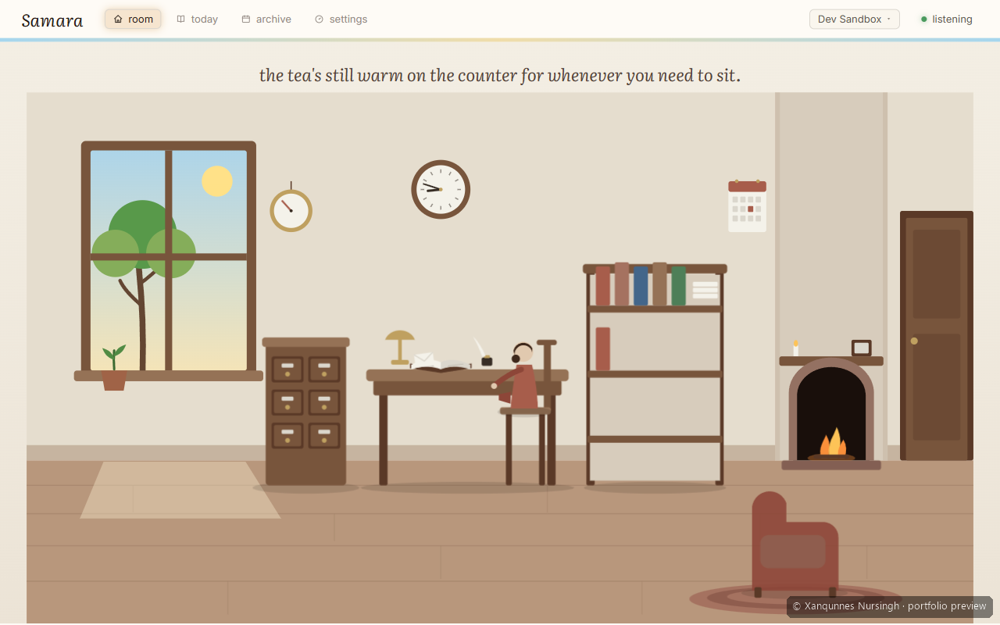
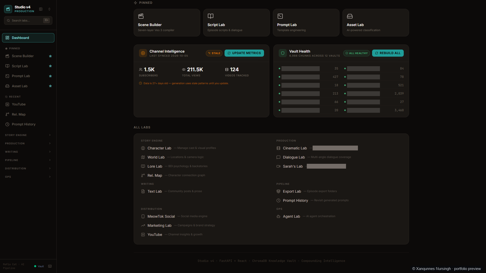
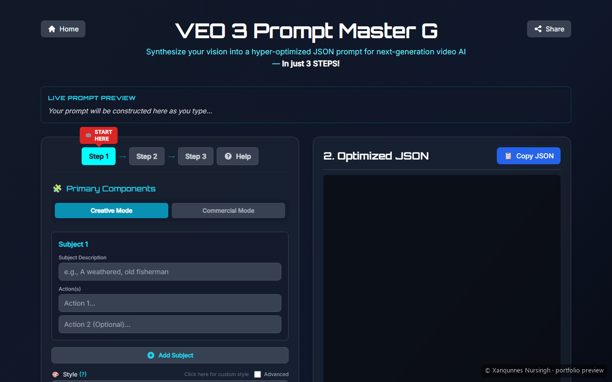

# Dr Xanqunnes Nursingh

**AI engineer and AI content creator**

A medical doctor by training who now builds and evaluates AI systems and makes AI video. I specify and verify what I build with Claude Code, I run models on my own GPU, and I measure whether things work before I say they do.

Open to remote contract and part-time work. Johannesburg, South Africa (SAST, UTC+2). Can start immediately.

## Proof

- 44 of 45 persona regression cases passing, run on 5 Aug 2026. See [how it was verified](https://promptmasterg.github.io/portfolio/work/samara/#verification).
- 6,988 chunks in a local knowledge store of 12 collections, built on ChromaDB with an embedding model that runs offline, counted on 1 Nov 2026. See [the AI Studio Tool](https://promptmasterg.github.io/portfolio/work/ai-studio-tool/#example).
- 44 MCP tools behind an orchestrator and ten specialist agents, counted on 1 Nov 2026. See [the agent team](https://promptmasterg.github.io/portfolio/work/ai-studio-tool/#agents).
- +1,466% LinkedIn followers at a biosciences company in 2024, creator-reported with no base figures, before I moved into AI video. See [Content before AI](https://promptmasterg.github.io/portfolio/content/#earlier).
- 3M views and 4K followers on a viral AI influencer I built on Instagram. See [the Content page](https://promptmasterg.github.io/portfolio/content/#numbers).
- 110+ videos, ~211K views in one series, read from the YouTube API on 5 Oct 2026. See [the numbers](https://promptmasterg.github.io/portfolio/content/#numbers).

## Work

| Preview | Project | What it is |
| --- | --- | --- |
|  | [Samara](https://promptmasterg.github.io/portfolio/work/samara/) | A local, offline AI journal for Windows, with a character called the Keeper. |
|  | [AI Studio Tool](https://promptmasterg.github.io/portfolio/work/ai-studio-tool/) | An MCP server that gives any agent an orchestrator and ten specialists to run a YouTube channel, beside a separate desktop app that holds the records and prompts for a real series. |
| 100-point rubric, seven sections | [Signal](https://promptmasterg.github.io/portfolio/work/signal/) | An app that grades YouTube videos on a written packaging rubric. |
|  | [Prompt Master G](https://promptmasterg.github.io/portfolio/work/prompt-master-g/) | A free browser tool for structured Veo 3 prompts. [Try it](https://veopromptai.netlify.app). |

Training: Vanderbilt University specializations in Generative AI Software Engineering (2026), AI Agents with Model Context Protocol (2025), Custom GPTs and Prompt Engineering (2024), as I list them.

Most of this work is private. I walk through it live on request.

## Contact

[promptmasterG@proton.me](mailto:promptmasterG@proton.me), [LinkedIn](https://www.linkedin.com/in/dr-xanqunnes-nursingh-6117a7229), [portfolio](https://promptmasterg.github.io/portfolio/)
