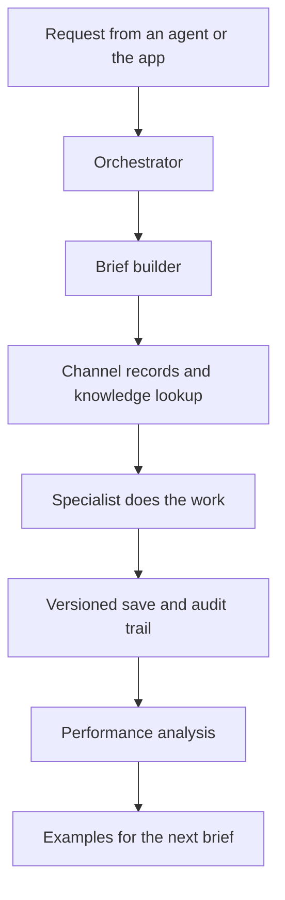

## The problem

A general-purpose agent knows nothing about one channel's voice, audience or past results unless someone supplies it every time, and a video model forgets a cast between episodes. I wanted an agent that arrives briefed, spends only what it may, and learns from the channel's own numbers.

## What it does

- Gives any MCP-capable agent a way to run a channel through .
- Builds a brief for every request from the channel's voice, audience and past corrections.
- Offers a free default path, where the connecting agent writes from the brief, and an opt-in paid path under hard spend ceilings.
- Versions and checksums everything it saves, with an audit log.
- Feeds the strongest hooks and titles from published videos back as examples for the next brief.

## The orchestrator and its specialists {#agents}

Behind the server sit . Each card names a role, says what it is for and shows a screen. For Scout, Strategist, Manager, Publisher and SEO the line is the wording of the Studio Deck's own panel for that role. The other five lines are my plain-words reading of the role, and their screens are the closest ones in the desktop app, so the pairing is not a wiring diagram.





## The Mafia Cats as the worked example {#example}

The Mafia Cats is a serialised AI comedy made with Veo 3, so it tests what the tool is for: the same cast and places across many episodes. The desktop app holds its  as structured records, assembles each prompt in layers, and warns when channel metrics are stale. Its documentation tells agents to query a knowledge store of  before they generate. The server and the app are separate programs. They share no code and do not call each other, and the series reaches the server only through an explicit import into a channel workspace.

## How it works {#how}

Components and data flow, in plain English. The lookup comes first, every time.

A request reaches the orchestrator, which asks the brief builder for context from the channel's own workspace. The lookup comes before any generation, and the stored record is always used. A specialist does the work, and everything saved is versioned. Performance data then feeds the next brief.

## Decisions and trade-offs

**Lookup before generation.** A forced query costs a round trip, which composite calls recover. In exchange, a scene starts from the record.

**Briefs instead of blind prompts.** The price is the work of keeping the channel's records accurate.

**A small tool catalogue.** It protects the connecting agent's context window, with the full manual fetched on demand.

**Physical isolation between channels.** Each channel has its own workspace and learning store, with no read path between them.

**Labelled heuristics and visible gaps.** The built-in quality check is a deterministic heuristic and is labelled as one, after I removed an LLM judge. The Studio Deck's server defines , so the documentation is behind the code.

## Verification and results {#verification}





The two codebases are counted separately, and no figure is added across them on this page. The production figures are mine and self-measured. The Deck's own TypeScript tests are not in the counts.

## What went wrong and what I corrected

An audit of the core loop found silent defects. I fixed each one and added a regression test. The documentation also went stale once, with the tool count no longer matching the code, so I corrected it. The production speed-up is my own measurement with no baseline, so I cannot say by how much.

## Skills this demonstrates

- Agents and MCP, with spend ceilings that stop a run.
- Retrieval over a multi-collection knowledge store.
- AI video production with structured cast and location records and layered prompt compilers.
- Full-stack delivery across Python, React, Tailwind, SQLite and Tauri, directed and verified by me and written with Claude Code.

## What I would do next

- Recount the tool catalogue and the specialist roster on a schedule.
- Add automated continuity checks. Today continuity is guidance in the agent playbooks, not a check.
- Record a walkthrough of the specialists running end to end, since most screens here are shown before a run.

## Access {#access}

The source is private. I am happy to walk through it live.

