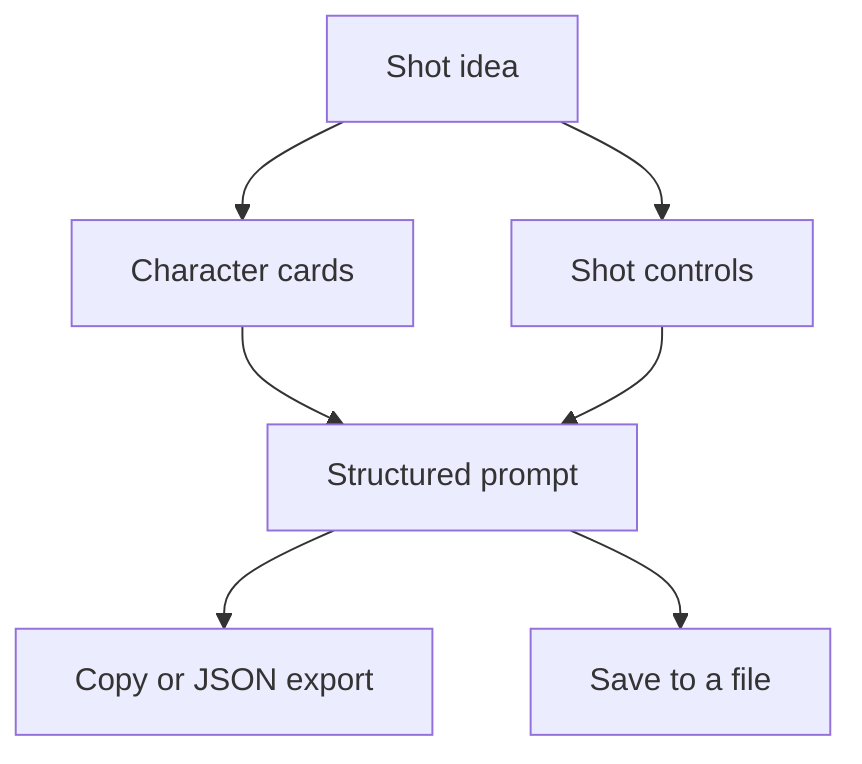

## The problem

The tool treats a Veo 3 shot prompt as separate parts: who is in the frame and what they do, how the camera moves, how the scene is lit, and what is heard. Writing that structure by hand for every shot is slow, and a structure that changes from shot to shot makes results change too. I built the tool to keep pace producing AI video, and it is free for anyone to use.

## What it does

- Turns a shot idea into a structured prompt in three steps, with a live preview and a JSON output panel.
- Uses character cards that say who does what in the shot.
- Treats shot type, angle, movement, lighting and music as separate controls, so changing one does not disturb the others.
- Adds a Commercial Mode with  for product work.
- Exports the result as JSON, and saves and loads prompts as a file.
- Runs entirely in the browser, so prompts never leave it.
- Publishes  beside the builder: cinematic camera shots, sound design, structured prompting, character consistency and dialogue.
- Carries a blog and short posts that I call bytes.

## How it works {#how}

Components and data flow, in plain English. Everything happens in the visitor's browser.

The builder keeps the parts of a prompt apart and joins them only at the end. Character cards and shot controls feed a single structured prompt, which the visitor can copy, export as JSON or save to a file. The prompt stays in the visitor's browser.

## Decisions and trade-offs

**Everything in the browser.** Prompts never leave the browser, so no server holds them and none can leak them. The price is that the tool cannot learn from what visitors write.

**Separate controls instead of one text box.** A single box invites the same inconsistency I built the tool to remove. Separate controls cost more screen space, and they make a prompt's structure visible.

**Cheat sheets published openly.** The guides are free to read without the builder, which makes them useful to people who never use the tool.

**A free tool as a portfolio piece.** It is the only project of mine a stranger can try today, so it carries the weight of proof for anyone who does not take my word.

## Verification and results {#verification}



Both figures were checked on the live tool on the date shown. I do not report usage figures here.

## What went wrong and what I corrected

I have no failure to report for this tool, and I am not going to invent one. The nearest limit sits in the series workflow the tool supports: the production speed-up there is my own measurement with no baseline, so I do not treat it as a benchmark.

## Skills this demonstrates

- Public communication, through cheat sheets and a free tool for AI video creators.
- Prompt engineering for video, with structure that separates who, what, camera, light and sound.
- Product thinking, with a privacy design in which prompts never leave the browser.
- Delivery of a live tool that a stranger can open and judge.

## What I would do next

- Find a way to learn how the tool is used without breaking the promise that prompts stay in the browser.
- Tie each cheat sheet to a worked example.

## Access {#access}

The tool is live at [veopromptai.netlify.app](https://veopromptai.netlify.app){:rel="noopener noreferrer"} and free to use.

The source is private. I am happy to walk through it live.

