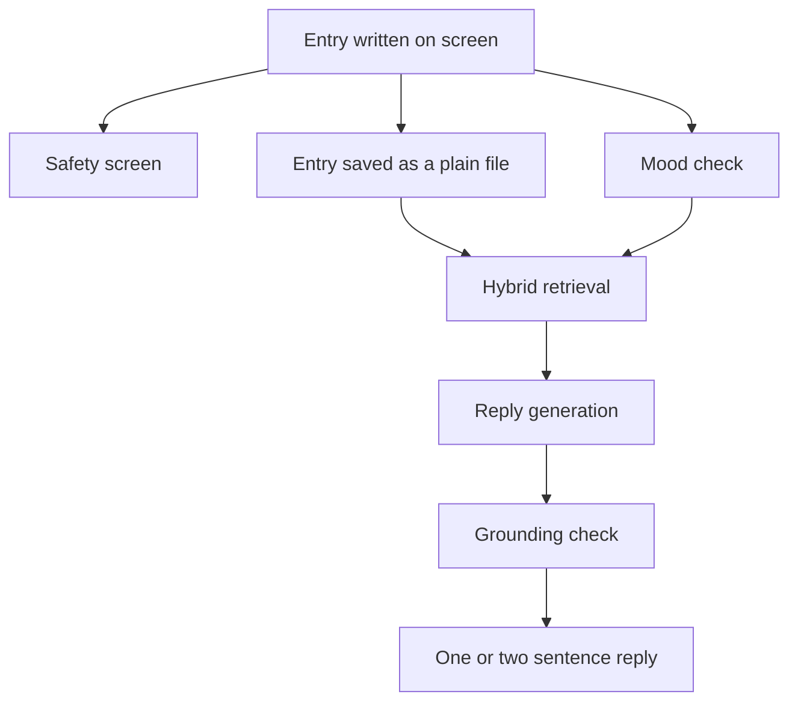

## The problem

The problem is a journal where nothing written can leave the machine, yet a reply still reflects what was written before. A cloud service cannot promise the first part, and a plain local editor cannot do the second.

## What it does

- Distraction-free writing with autosave, atomic writes, versioned backups and a full export.
- A pixel-style character called the Keeper replies in one or two sentences, held there by a token cap, and writes weekly letters and an annual recap from retrieved moments.
- Separate journal Spaces for each person, an optional PIN, and burn-after-writing entries that live only in memory.
- Voice entries through local speech-to-text, semantic search, and callbacks on day three that refer to something you actually wrote.
- It runs fully offline by design, with no telemetry, update checks or cloud calls.

## How it works {#how}

Components and data flow, in plain English. The safety screen sees every entry whether or not the model is involved.

Entries are plain files, and the index can always be rebuilt from them. A deterministic safety screen for crisis language runs on every entry, independent of the model, and I make no claim that it is clinically validated. A chain of small single-purpose model calls handles the rest, and every structured call is grammar-constrained so its output is valid by construction. Retrieval runs vector search and keyword search together and fuses them by reciprocal rank. A post-check then rejects any reply that cites a specific that was not retrieved.

## Decisions and trade-offs

**A local model instead of a cloud service.** The promise is that nothing written leaves the machine, so inference runs on the user's hardware. The price is speed: the  model generates  on a consumer GPU and  on CPU only.
{: #engine}

**A stable prompt prefix.** I keep the start of every prompt byte-for-byte identical so the cache can be reused. A warm call reached . Any change to that prefix throws the cache away.

**A grounding gate instead of trust.** Callbacks may only reference retrieved text, and biography chapters need entry receipts and verbatim quotes.

**Declined after measuring.** N-gram speculation accepted no draft tokens on CPU, a different quantised checkpoint did not earn its place, draft prefill warming was built, measured and reverted, and a smaller micro-batch was slower on CPU. Multi-token speculative decoding shipped on the full-GPU tier only.

## Verification and results {#verification}



The speed numbers come from one development machine. The app is in development, and I make no claim about users, a release or an independent audit. The acceptance test for the privacy promise is a full session in airplane mode, and this page reports no result for it.

## What went wrong and what I corrected {#corrected}

I estimated CPU prompt processing at  for a  prompt, extrapolating from generation speed. Measuring gave , so the estimate was off by , and I amended the plan on 3 Aug 2026.

The adversarial testing of the companion guardrails did not go well at first: . I fixed both defects and re-ran the cases.

During the companion-ethics pass I found a persona-guide table that had been teaching callbacks based on attendance. I removed it, and letters and callbacks now refer to content and never to missed days. A plain text editor also stripped entry metadata through line endings, which I fixed.

## Skills this demonstrates

- Local inference and tuning: measured throughput, cache reuse and declined optimisations.
- Retrieval and grounding: hybrid search behind a gate that rejects ungrounded replies.
- Evaluation: a regression suite and adversarial cases, with the failures kept.
- Safety, privacy and ethics: a screen independent of the model, an offline promise tested in airplane mode, and an audit of companion-app harms.
- Full-stack delivery across Rust, React, TypeScript and SQLite, written with Claude Code under my direction.

## What I would do next

- Look into the one case in the persona suite that did not pass on the last run.
- Repeat the speed measurements on a second machine, since every speed figure here comes from one.
- Put the app in front of a small group of real writers.

## Access {#access}

The source is private. I am happy to walk through it live.

