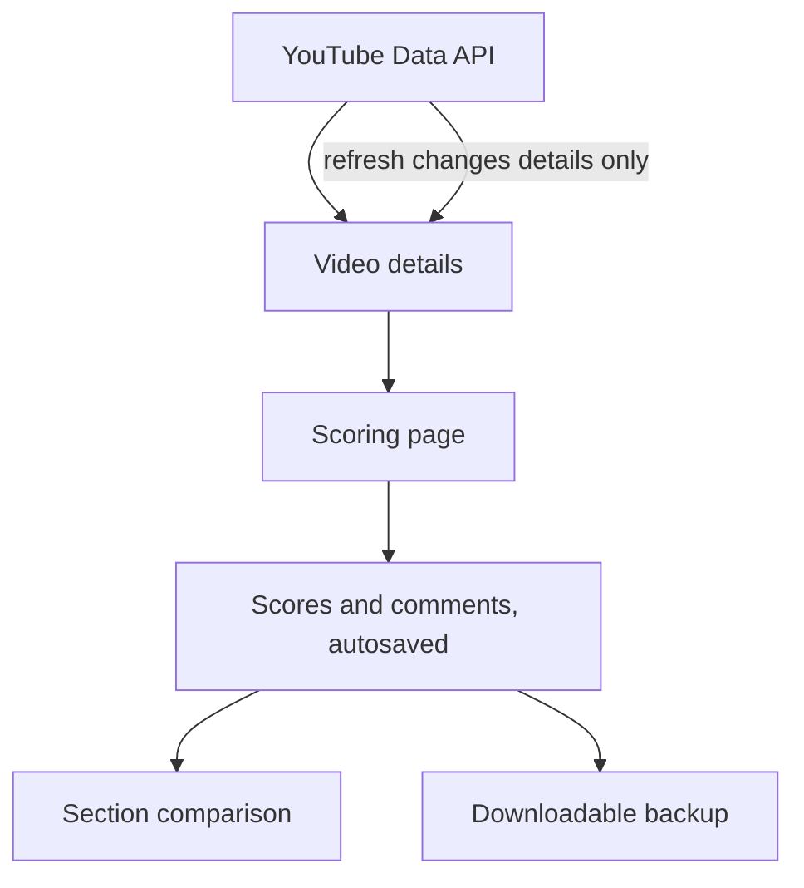

## The problem

Packaging decides whether a video gets a chance. I needed a written rubric applied the same way to my own videos and to a competitor's, with the scores kept somewhere I could compare them section by section.

## What it does

- Scores any YouTube video on , covering packaging and retention.
- Offers one slider per criterion, with half marks, section sub-totals and a sticky running total.
- Autosaves, and shows the saved state so a score is never in doubt.
- Compares my channel with a competitor, section by section, across several channels.
- Refreshes video metadata on demand without ever touching a score or a comment.
- Exports a downloadable backup, so the claim that the app is self-contained can be checked.
- Ships a plain-language manual, and refuses to invent criteria for topics the curriculum has not yet taught.

## How it works {#how}

Components and data flow, in plain English. A refresh can change video details and nothing else.

The rubric exists once, and the API, the dashboard and the scoring page all follow that single source, so a change cannot reach one without the others. Video details are read-only copies from the YouTube Data API. Scores and comments are mine, and nothing in the refresh path is allowed to write to them. The section weights are in the panel at the top of the page.

## Decisions and trade-offs

**One source of truth for the rubric.** Three parts of the app need to agree on the criteria, and keeping one definition is cheaper than keeping them in step. The price is that the definition becomes the thing every change must go through.

**A refresh that can only touch metadata.** I made the refresh write only to read-only video details, so the worst case is stale details and never a lost score.

**Sliders instead of stepper buttons.** The second version replaced steppers with one-drag sliders, added a sticky running total and a proper design system.

**A backup file as proof.** A downloadable JSON backup lets anyone see that the app holds everything it claims to.

## Verification and results {#verification}



Signal's history is the clearest record I have of changing a design after hands-on feedback. It began as  and has had .

## What went wrong and what I corrected

The first version was checked only through DOM and API tests, and I never looked at it. When I did, it was boring and hard to use, and I rejected it. The project manifest now requires checking in a real browser before the work counts as done.

The later versions came from the same habit. The second pass replaced steppers with sliders and added a sticky total, the third added comparison across channels, and the next added refresh and a plain-language manual.

## Skills this demonstrates

- Product sense and iteration: a spreadsheet became an app, then changed again after hands-on use.
- Analytics: a rubric tied to retention and click-through, applied to my own channel and a competitor's.
- Reliability by design, through a refresh that cannot overwrite a score.
- Verification in the running app, with a rule that browser checks come first.
- Full-stack delivery across React, Node, Express and SQLite, directed and verified by me and written with Claude Code.

## What I would do next

- Compare section scores against retention data for the same videos, to find out which sections predict anything.
- Track how consistent my own scoring is when I regrade an old video.

## Access {#access}

The source is private. I am happy to walk through it live.

